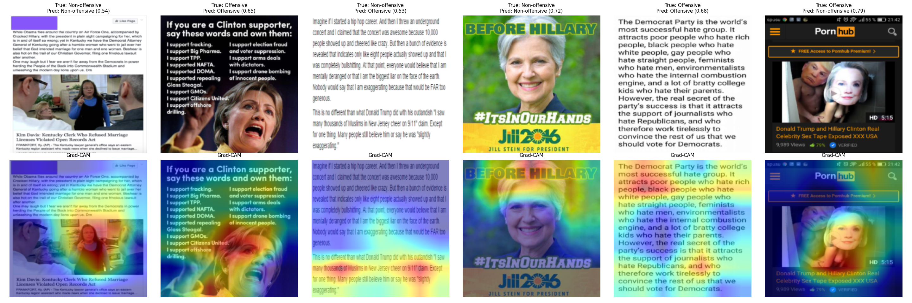

# Hate Speech Detection (Multimodal: Text + Image)

**Status:** ✅ Deployed — [try the live demo](https://hate-speech-detection-dd7q.onrender.com)

A 3-class hate speech / offensive language / neither classifier, built as an
end-to-end system: data pipeline → model ladder (classical ML → BiLSTM →
CNN-BiLSTM → attention → DistilBERT) → multimodal text+image fusion model →
FastAPI backend → React frontend → free-tier deployment on Render.

**Heads up on first load:** the free-tier instance spins down after ~15
minutes idle, so the first request after a while can take 30-50s to wake it
back up — subsequent requests are fast (text predictions typically respond
in well under a second). See [Deployment](#deployment-free-tier-memory-engineering)
below for why that specific number, and for an important disclosed
limitation of this deployment (the image mode's visual explainability
overlay is intentionally disabled here due to free-tier memory limits —
classification itself is unaffected).

## ⚠️ Responsible use disclaimer

This is a **content-moderation-assistance research/portfolio project**, not a
"hate speech accusation machine." Predictions are probabilistic, can be
biased (see the bias audit sections below, once completed), and must not be
used as the sole basis for real moderation decisions against real people.

## Project structure

See `src/` for the data/model code, `notebooks/` for exploratory analysis,
`app/` for the FastAPI backend (`app/` and `src/api.py`) + React frontend
(`app/frontend/`), and `tests/` for unit/integration tests.

One-off scripts at the repo root document the deployment journey and are
meant to be re-run, not just read — see
[Deployment](#deployment-free-tier-memory-engineering) for what each one
does and why it exists: `export_onnx_model.py`, `compare_onnx_vs_torch.py`,
`verify_light_tokenizer.py`, `memory_probe.py`, `memory_probe_onnx.py`,
`diagnose_tokenizer_load.py`. `export_quantized_model.py` is kept for
historical reference but is **superseded** by `export_onnx_model.py` — it
produced an earlier, torch-based quantized model that turned out not to
fix the actual memory problem (see below).

## Multimodal (Image + Text) Results

**Dataset:** MultiOFF (Suryawanshi et al., 2020, LREC/TRAC-2) — 743 memes from the
2016 US election, binary offensive/non-offensive labels. A small, peer-reviewed
academic benchmark, not a large-scale dataset — this matters for interpreting
the numbers below.

| Model | test macro-F1 | test accuracy |
|---|---|---|
| Image-only (ResNet18) | 0.5117 | 0.5302 |
| **Text-only (DistilBERT)** | **0.6573** | **0.6846** |
| Fusion (concatenation) | 0.5533 | 0.5839 |
| Fusion (concatenation, warm-started) | 0.5621 | 0.5906 |
| Attention/gated fusion | 0.5143 | 0.5302 |
| Attention/gated fusion (warm-started) | 0.5411 | 0.5436 |

**Finding: fusion did not outperform text-only alone on this dataset**, despite
trying two credible architectural fixes (a learned gate to down-weight the
noisy image branch, and warm-starting each encoder from separately-trained
checkpoints instead of generic pretrained weights). Neither closed the gap.

This is consistent with published literature, not a shortfall of this
implementation:
- The original MultiOFF paper's own best multimodal model reported ~50%
  accuracy (Suryawanshi et al., 2020).
- On the much larger (10,000-image), professionally-curated Facebook Hateful
  Memes Challenge — with 3,173 competing teams using large pretrained
  vision-language transformers — the **winning submission reached 73.2%
  accuracy**, third place 76.5%, and **human accuracy on that task is 84.7%**.
  Meme-based multimodal hate/offensive detection is a genuinely hard task
  industry-wide, not something a bigger model alone fixes.

For comparison: the exact same DistilBERT architecture, fine-tuned on this
project's much larger text-only dataset (24,783 rows), reached **89.94%
accuracy**. Same methodology, same model family — the gap here is dataset
size (445 vs. 24,783 training rows), not model quality.

## Bias Audit: AAVE vs. Standard American English (Required Check)

The Davidson-style dataset is documented in fairness research (Sap et al., 2019,
"The Risk of Racial Bias in Hate Speech Detection") to over-flag African-American
Vernacular English (AAVE) as offensive. We tested this directly with 20
hand-constructed sentence pairs — each pair expresses the same clearly benign,
everyday sentiment (no offensive content in either version), once in AAVE, once
in Standard American English. True label for every pair is "Neither"; any gap in
false-positive rate reveals dialect bias.

| Model | AAVE false-positive rate | SAE false-positive rate | Gap |
|---|---|---|---|
| Baseline (TF-IDF + LogReg) | 40.0% | 20.0% | **20.0 pts** |
| **DistilBERT (deployed model)** | **0.0%** | **0.0%** | **0.0 pts** |

**Baseline reproduces the documented bias clearly** — e.g. "that test was hard as
heck" flagged Offensive, "that test was very difficult" not; "she got mad skills
at drawing" flagged, "she has a lot of skill" not. This confirms the audit is
genuinely sensitive, not trivially passing everything.

**DistilBERT shows zero gap on this test** — the model we've chosen to deploy
does not reproduce the classic AAVE bias. Testing baseline alongside it is what
makes this credible: a clean result on an audit that catches nothing would prove
little.

**Scope limitation, stated honestly**: this audit measures false positives on
clearly *benign* text only. It does not test whether genuinely offensive AAVE
content is treated differently than equivalent offensive SAE content, or whether
model *confidence* (not just the final prediction) differs by dialect. Those
would be reasonable extensions, not covered here.

## Image-Specific Bias Check (Required Check)

Tested whether the image-only model's prediction changes under three superficial
perturbations that don't alter actual content: a skin-tone-like hue shift,
brightness adjustment, and background blur (n=20 test images).

| Perturbation | Flip rate | Mean Δ P(offensive) | p-value (paired t-test) |
|---|---|---|---|
| Hue shift | 15.0% | −0.063 | 0.045 |
| Brightness | 20.0% | +0.002 | 0.943 |
| Blur | 20.0% | −0.026 | 0.437 |

**No strong evidence of systematic bias.** Brightness and blur show no meaningful
signal. Hue shift shows a small, borderline-significant decrease in predicted
offensiveness (p=0.045) — but with 3 perturbation types tested, the
multiple-comparison-corrected threshold is p<0.017, which this does not clear.
We report this as a mild trend worth a larger follow-up sample, not a confirmed
finding — over-claiming either "no bias" or "confirmed bias" from n=20 would be
dishonest in either direction.

Context: the image-only model's overall signal is weak (test macro-F1 0.51,
barely above chance), so some prediction instability under any perturbation,
including content-irrelevant ones, is expected on its own and doesn't
automatically indicate targeted bias.

## Qualitative Error Analysis (Required)

DistilBERT misclassified 375/3718 test examples (10.1%). Sample of 15 examined
directly, plus LIME explanations on 5, reveal a consistent pattern:
(For context: 10.1% error rate is exactly consistent with DistilBERT's already-reported
89.94% test accuracy — this is the same result restated as a raw count, not a new or
worse finding. The "15 examples" below is a manually-reviewed qualitative sample, not
a claim that only 15 total errors exist.)

**The model's decisions are driven heavily by the presence of specific lexical
triggers (particular slurs), not deeper contextual understanding of intent or
target.**

- **Slur presence overrides context** (dominant pattern): personal insults using
  slurs (annotated "Offensive") get escalated to "Hate Speech" purely because a
  slur is present, regardless of whether the speech is actually targeted,
  systematic hate against a group. LIME confirms this directly — in all 5
  explained examples, one slur token carries +0.4 to +0.8 weight, an almost
  single-word-decisive influence (e.g. "faggot" +0.556 in a tweet that's road-rage
  directed at one driver, not group-targeted hate).
- **Offensive content without explicit slur vocabulary gets missed**: coded/
  indirect language ("ghetto," "monkey," ableist slang used non-personally) is
  frequently misclassified as "Neither" when it avoids the model's apparent
  learned trigger vocabulary.
- **The same pattern misfires the other direction**: a wordplay/rhyme tweet
  referencing "Aunt Jemima" (annotated "Neither" by humans) gets flagged
  "Offensive," apparently from the racially-loaded reference alone, without
  grasping it wasn't used as an attack.

This is a genuine limitation worth stating plainly, not something to hide — and
it's partly a reflection of real difficulty in the underlying task: the original
Davidson dataset paper documents low inter-annotator agreement on exactly this
Hate-vs-Offensive boundary, because the distinction is subtle even for humans.
We are not attempting to engineer around this here; it would require richer
contextual modeling or better-labeled training data distinguishing "slur as
personal insult" from "slur as targeted hate," beyond this project's scope.

Full misclassified set: `results/misclassified_examples_full.csv`.
LIME explanations: `results/lime_explanations.json`.

## Grad-CAM: Image Model Explainability (Required)

Visualized which regions of 6 test images the image-only model's CNN attended to.

| Image | True | Pred | Confidence |
|---|---|---|---|
| Kim Davis screenshot | Non-offensive | Non-offensive | 0.54 |
| "Clinton supporter" meme | Offensive | Offensive | 0.65 |
| "Hip hop career" text meme | Non-offensive | **Offensive (wrong)** | 0.53 |
| "Before Hillary" (Jill Stein) | Non-offensive | Non-offensive | 0.72 |
| "Democrat Party hate group" text | Offensive | Offensive | 0.68 |
| Pornhub screenshot | Offensive | **Non-offensive (wrong)** | 0.79 |

**Key finding**: for text-heavy memes, the model's attention concentrates heavily
on the text block itself — visually looking like it's "reading" the content. It
isn't and structurally can't be: ResNet18 has no OCR capability. What it's
actually detecting is generic visual texture (text-dense regions have a
distinctive pixel pattern), not semantic meaning. This is a concrete, visual
explanation for why the image-only branch performs near chance (0.51 macro-F1)
despite producing focused-looking heatmaps — the attention is real, but the
signal it's keying on (how much dense text an image contains) is a weak proxy
for actual offensiveness. This directly reinforces the earlier decision to route
image inputs through OCR + text-only DistilBERT in the deployed app rather than
the vision branch: this is now visual evidence for that decision, not just the
macro-F1 comparison alone.

On the two images containing a clear human face (a shouting-expression photo, a
politician's portrait), attention concentrates on the face/person specifically —
a more plausible case of genuine visual signal, distinct from the text-block
pattern-matching seen elsewhere.

## Live API Testing (Post-Deployment)

Testing the deployed API with real memes and hand-written text surfaced both a
real fix and a broader finding than offline error analysis alone caught.

**OCR fix (partial success, disclosed honestly):** the multi-variant OCR
approach successfully recovered previously-missed meme text on one real image
("YOU MEAN GAY LEMONADE?" overlay, previously invisible to OCR entirely) — but
failed to fully recover text on a second, more visually complex real image
(garbled "MUSLIM STUDENT" into "UR CLASS" against a busy fire-photo background).
The fix is a genuine, verified improvement, not a complete solution — OCR on
visually complex real memes remains a real limitation.

**New finding: over-escalation to "Hate Speech" is broader than slur tokens.**
Offline error analysis found slur presence triggers this. Live testing found
plain insults with no slur or group targeting do too: `"shut up you absolute
idiot"` classified as Hate Speech (72.5% confidence) with no offensive/targeted
language present at all. This suggests the model's Hate-Speech trigger responds
to strong negative sentiment generally, not only specific slur vocabulary — a
broader version of the limitation than previously documented.

**Positive finding: appropriate uncertainty on ambiguous inputs.** Genuinely
unclear cases ("kill it with fire," "you people are the worst") produced low
confidence (44-66%) rather than confident wrong answers — the model hedges
appropriately rather than overclaiming certainty on hard cases.

## Counterfactual Data Augmentation: Fixing What Live Testing Found

Live API testing (previous section) surfaced two real problems beyond what offline
error analysis alone caught. Rather than just document them as limitations, we
fixed them using Counterfactual Data Augmentation (Dixon et al., 2018) — adding
114 targeted, hand-labeled examples (severity-graded personal insults, genuine
group-targeted hate, and benign identity-term sentences) to the training data,
with severity examples oversampled 3x after an unoversampled first attempt showed
no measurable effect.

**Held-out evaluation (new phrasings, not seen in training) confirms real,
generalized fixes:**

| Metric | Before | After |
|---|---|---|
| test macro-F1 | 0.7663 | 0.7504 |
| Severity monotonicity (held-out) | 1/6 correct | **5/6 correct** |
| "queer" identity-term gap | −60.2pp | **−6.3pp** |
| Identity-term spread (best↔worst) | 73.4pp | **18.6pp** |
| AAVE dialect bias regression check | 0% gap | **0% gap (confirmed no regression)** |

**The macro-F1 cost (−1.6 points) is real and disclosed, not hidden** — a
deliberate trade-off, not an oversight. The augmented model remains competitive
as the #2 model across our entire 7-model comparison (tied with CNN-BiLSTM),
just no longer the outright #1.

**A 2x-oversampling variant was tested and explicitly rejected**, despite a
*higher* macro-F1 (0.7769): it only partially fixed identity calibration
("queer" still at −45.4pp) and reintroduced a real AAVE false positive
("Ain't nobody got time for that" → wrongly flagged Offensive). Chasing the
better benchmark number there would have meant shipping a worse model on the
property that actually mattered — recorded here explicitly so that trade-off
stays visible.

**This is the model now deployed** at
[huggingface.co/Prat-04/hate-speech-distilbert](https://huggingface.co/Prat-04/hate-speech-distilbert),
replacing the pre-augmentation version. Full model card includes all of the
above. (The production API serves an ONNX-exported, int8-quantized export
of this exact model, not the raw PyTorch checkpoint — see
[Deployment](#deployment-free-tier-memory-engineering) for why, and for a
full accuracy comparison confirming the export changes nothing material.)

## Deployment: Free-Tier Memory Engineering

Deployed as a Docker container on Render's free Web Service tier: **512MB
RAM, 0.1 vCPU, no persistent disk**. Fitting a transformer NLP model, an
explainability library, an OCR engine, and a second vision model into that
budget took four real iterations — each one fixing what the previous one
exposed, each disclosed here rather than smoothed over.

**The journey:**

1. **Float32 load + runtime quantization → OOM.** Loading the model in full
   precision and then calling `quantize_dynamic()` needs the float32
   original AND the new quantized copy in memory simultaneously, even if
   only for a moment. That moment was enough to get OOM-killed on the
   512MB free instance.
2. **bfloat16 load → fixed memory, broke latency.** Loading directly in
   bfloat16 (`low_cpu_mem_usage=True`) avoided ever materializing a float32
   copy and fixed the OOM — but most CPUs, including Render's free
   instances, have no fast native bfloat16 math and emulate it, which can
   be as slow as (or slower than) plain float32. Combined with LIME's ~100
   forward passes per text request on a throttled 0.1 vCPU, responses took
   3-4 minutes and Render's 5-second health-check timeout killed the
   service mid-request.
3. **Pre-quantized int8 .pt file → still OOM, further upstream than
   expected.** Quantizing offline (`export_quantized_model.py`) and
   `torch.load()`-ing the finished int8 file directly seemed like the
   fix — no float32 copy ever created, genuinely faster CPU kernels. It
   still OOM'd. A staged memory probe (`memory_probe.py`) traced why:
   **`import torch` alone cost ~165MB**, before a single weight loaded, and
   loading even the *already-quantized* model added **another ~187MB on
   top** — almost certainly PyTorch initializing its quantized-GEMM backend
   (fbgemm/qnnpack) on first use, a cost tied to the framework, not the
   model's file size. Total steady-state: **~660MB**. The model was never
   really the problem — the library stack underneath it was.
4. **ONNX Runtime + a torch-free tokenizer → the actual fix.** The text
   model is now exported to ONNX and quantized via
   `onnxruntime.quantization` (`export_onnx_model.py`), served through
   `onnxruntime.InferenceSession` instead of torch+transformers
   (`src/api.py`). `onnxruntime`'s import footprint is a fraction of
   torch's, and loading a pre-quantized `.onnx` file doesn't trigger a
   comparable backend-init tax. A second, less obvious culprit turned up
   along the way: `transformers.AutoTokenizer.from_pretrained()`
   unconditionally imports torch internally — confirmed directly by diffing
   `sys.modules` before/after the call (`diagnose_tokenizer_load.py`) —
   regardless of the `USE_TORCH=0`/`USE_TF=0` environment variables
   transformers documents for exactly this situation (tried first; had zero
   effect). `src/light_tokenizer.py` loads the same `tokenizer.json` file
   directly through the lightweight `tokenizers` library instead (the same
   Rust backend `AutoTokenizer`'s fast tokenizers wrap internally),
   verified byte-identical to `AutoTokenizer`'s output across truncation,
   padding, and batch edge cases (`verify_light_tokenizer.py`).

**Result — measured, not estimated** (`memory_probe_onnx.py`):

| | Before (int8 .pt + torch) | After (ONNX + light tokenizer) |
|---|---|---|
| Steady-state memory, text serving | ~660MB | **~284MB** |
| Fits in 512MB free tier? | No | **Yes, with ~228MB headroom** |
| LIME explainability | kept | **kept** |

**Accuracy validated, not assumed** (`compare_onnx_vs_torch.py`, full
3,718-row held-out test set — the same split used for every other metric in
this README): the quantized ONNX model's accuracy (0.8835) and macro-F1
(0.7576) are *marginally higher* than the original float32 model's (0.8776
/ 0.7486), with a 1.69% prediction-disagreement rate and no systematic bias
toward either model. Quantization cost nothing measurable here.

**A second, separate OOM, and a disclosed trade-off.** Fixing text serving
didn't fix `/predict/image`: the lazy-loaded Grad-CAM diagnostic path
(image-only ResNet18, used purely for the attention-overlay visualization,
never for the actual classification) still has to import torch +
torchvision + transformers + a second model all at once on first use — on
top of the ~284MB already resident for text serving, that doesn't fit
either, and caused a real 502 in production. Rather than attempt a third
memory trick on an already-weak model (test macro-F1 0.51, see above), the
Grad-CAM overlay is **disabled on this deployment** (`ENABLE_IMAGE_GRAD_CAM=0`
in the Dockerfile, gating `GRAD_CAM_ENABLED` in `src/api.py`) and the API
says so directly in its response rather than silently omitting it. This
does **not** affect classification — OCR + the text model produce the
actual prediction in `/predict/image` either way and use none of
torch/torchvision. Run the project locally (`uvicorn src.api:app --reload`,
no environment variable set) to see the full Grad-CAM feature.

## Progress log

- [x] Repo initialized, `.gitignore`, requirements scaffolded
- [x] Text data loaded, cleaned, EDA complete
- [x] Baseline (TF-IDF + LogReg/SVM)
- [x] BiLSTM
- [x] CNN-BiLSTM
- [x] BiLSTM + Attention
- [x] DistilBERT fine-tune
- [x] Text bias audit
- [x] Multimodal dataset inspected
- [x] Image + fusion branch
- [x] Multimodal bias audit
- [x] Qualitative error analysis (10-15 misclassified examples, categorized)
- [x] LIME explainability (text predictions)
- [x] Grad-CAM visualizations (image predictions)
- [x] FastAPI backend
- [x] Frontend
- [x] Deployment (Render, free tier — see
      [Deployment](#deployment-free-tier-memory-engineering) for the memory
      engineering this took)
- [ ] CI (automated test suite exists in `tests/`, but no pipeline runs it
      automatically yet — tests currently require running manually against
      a real environment with internet access to Hugging Face Hub)

## License

MIT — see `LICENSE`.
